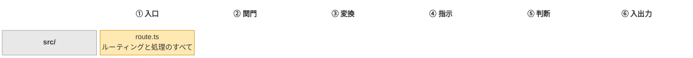
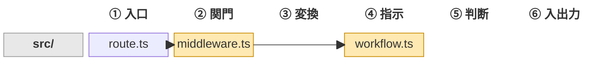
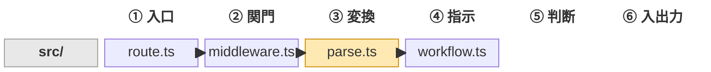
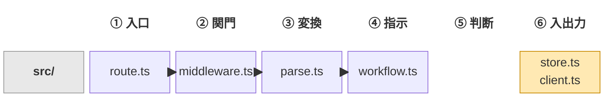
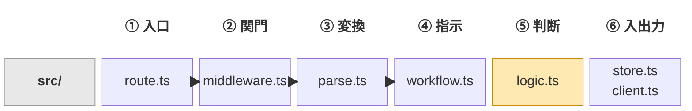
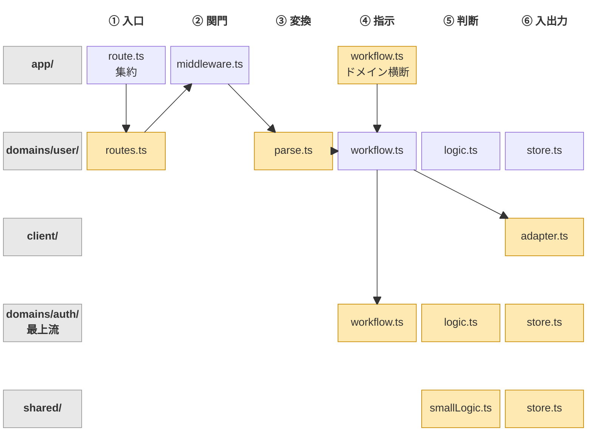
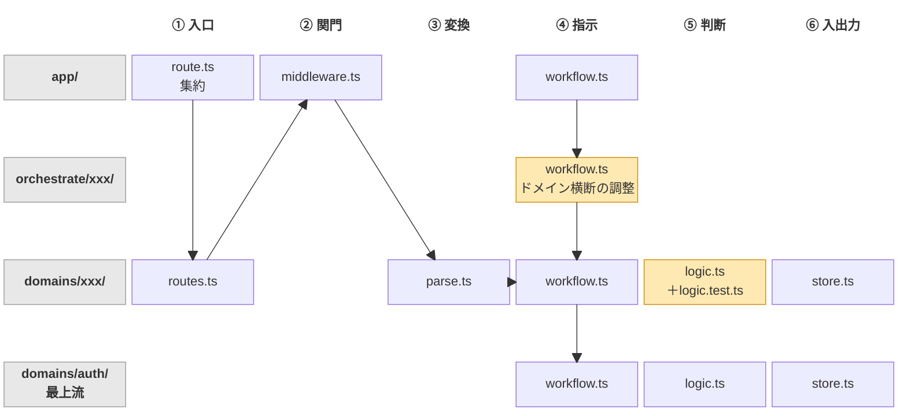
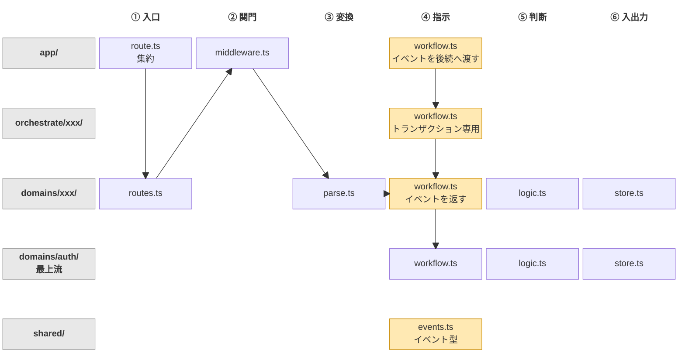
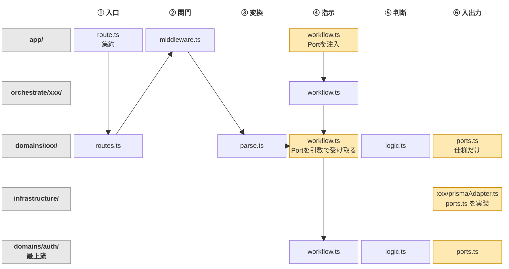
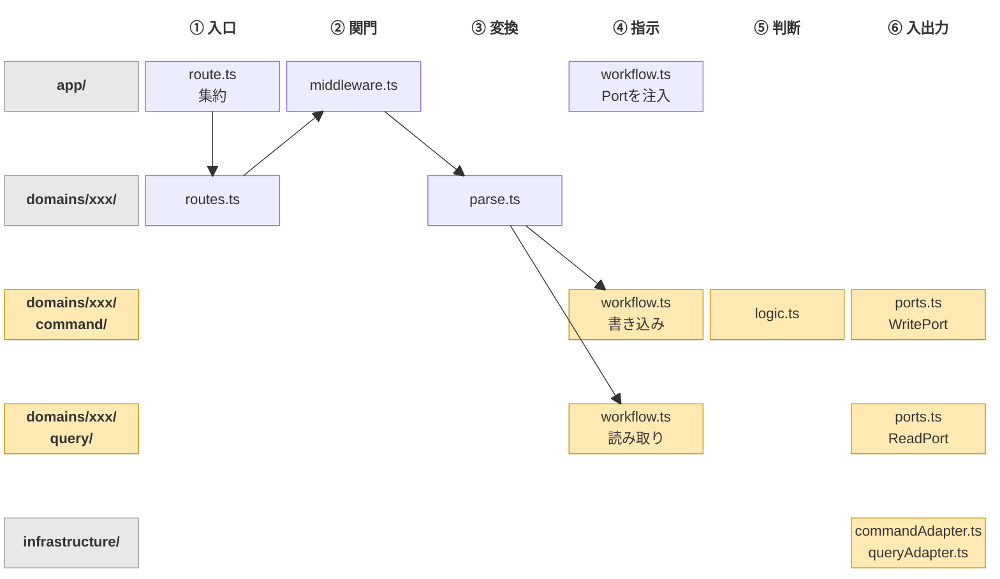

# Lv別アーキテクチャリファレンス

> **このドキュメントの目的：** 各Lvの「完成形スナップショット」を提供する。
> 「なぜこの設計か」の根拠・背景は[進化論ドキュメント](./🤤%20僕の考えた最強の次世代Webアプリケーションアーキテクチャ（進化論）.md)と[補足資料](./Kaachan%26Slime%26Slime%20Architecture構想の設計根拠、補足資料.md)を参照。
> このドキュメントは `rules/_content/lv*.md`（AI向けルールテンプレート）の日本語正本として機能する。
>
> **正本の扱い：** 文書間で記述が食い違った場合は、このドキュメントが優先する。進化論は設計の物語、補足資料は設計判断の記録、FW文書とKaachan設計仕様はツールの仕様という位置づけ。
> ただしKaachanの検査項目と重大度だけは `src/rules-catalog.ts` が唯一の正で、本書の「Kaachanが検査する項目」と末尾の一覧表はそこから自動生成している（`npm run build:rules`）。重大度を変えるときは `src/rules-catalog.ts` を編集する。

---

## 構造図の読み方

各Lvの「構造図」は、処理の流れと構造の層を縦横の軸にした図。

- **横軸は処理の流れ**：① 入口（route）→ ② 関門（middleware）→ ③ 変換（parse）→ ④ 指示（workflow）→ ⑤ 判断（logic）→ ⑥ 入出力（store・client・ports）
- **縦軸は構造の層**：Lv1〜5は `src/` の1行だけ。Lv6以降は `app/`・domain・`client/`・`shared/` などのフォルダが行として増える
- Lv1〜5（層の時代）は図が横に伸び、Lv6以降（構造の時代）は縦に伸びる。進化論の「層の時代」から「構造の時代」への転換が、図の伸びる向きの変化として見える
- **黄色の箱**は、そのLvで新しく登場した、または役割が変わったもの
- **矢印**はリクエストの流れと、行をまたぐ呼び出し
- **矢印を描いていない呼び出し**：④ 指示の右側（判断・入出力）は、同じ行のWorkflowから呼ばれる。logicとstoreの間に呼び出しはない（矢印を引くとlogicの上を横切ってしまうため省略している）

> 図はMermaidの `block-beta` 図式で書いている。Mermaid 12.2で描画を確認した。GitHub・Qiita・VS Codeのプレビューなどで表示できるかは、各環境が対応しているMermaidの版による（VS Code標準のプレビューはMermaid自体に対応していないため、拡張機能が必要）。

---

## Lv1 — ルーティングのみ

### ディレクトリ構造

```
src/
  route.ts    # HTTPルーティングとリクエスト処理のすべて
```

### 構造図

`route.ts` の1マスだけ。ここから横に伸びていく。



### レイヤールール

| ファイル | やること | やらないこと |
|---|---|---|
| `route.ts` | HTTPルート定義（メソッド・パス・ハンドラー）、インラインハンドラーOK | — |

- `/api` 名前空間は初日から `route.group({ prefix: '/api' })` で確保する（将来のwebルートとの衝突を防ぐため）

```ts
route.group({ prefix: '/api' }, (r) => {
  r.get('/health', (req, res) => res.json({ ok: true }))
  r.post('/users', CreateUserHandler)
})
```

### エラーハンドリング

- 未捕捉のthrowはFWが500にマップ
- 4xxは `res.status(4xx).json(...)` で明示的に返す

### Kaachanが検査する項目

<!-- BEGIN GENERATED: kaachan-checks lv=1 （src/rules-catalog.ts から自動生成。手で編集しない） -->
なし（このLvで検査する項目はない）
<!-- END GENERATED -->

### 🆕 Lv1で追加されたこと

初期Lv。すべての起点。

---

## Lv2 — Workflow + Middleware

### ディレクトリ構造

```
src/
  route.ts        # HTTPルーティングのみ
  workflow.ts     # リクエストオーケストレーション
  middleware.ts   # 認証・レートリミット・CORS等
```

### 構造図

入口の後ろに、関門（`middleware.ts`）と指示（`workflow.ts`）が並ぶ。



### レイヤールール

| ファイル | やること | やらないこと |
|---|---|---|
| `route.ts` | ルート定義・Middleware付与・Workflow指定 | ビジネスロジック・DB・レスポンス生成 |
| `middleware.ts` | HTTPの関門：HTTP固有の関心事（CORS・レートリミット・署名検証・ロギング等）、資格情報からプリンシパルへの変換、ロール単位の粗い認可 | 業務判断、リソース単位の認可 |
| `workflow.ts` | 1リクエストのend-to-endオーケストレーション | Middlewareの責務（認証等） |

- Middlewareはルートごとに**明示的に付与**する（フォルダ規約による自動適用禁止）
- Middlewareは「HTTPの関門」。認証とは、Cookie・Bearerトークン等の資格情報を**プリンシパル**（誰の権限で実行されているかを表す値。ユーザー・外部サービス・システム・匿名のいずれか）に変換する仕事である
- 関門の判定に必要な読み取り（セッション照会等）は行ってよい。業務判断はしない
- 「この投稿を編集できるのは作成者だけ」のような**リソース単位の認可**は、リソースを読むまで判定できないためMiddlewareでは行わない（Lv5以降はLogicの仕事）
- HTTPの関門でしか使わない関心事（CORS・IP制限等）はMiddlewareだけで完結させる。Middleware以外のコードも必要とする関心事（認証の照会処理等）は、Lv6以降は上流domainとして置き、Middlewareはそれを呼ぶ
- `/health` 等のインフラ用ルートは `/api/` グループの外に置く

```ts
// route.ts
route.group({ prefix: '/api' }, (r) => {
  r.post('/users',    CreateUserWorkflow)                    // Middlewareなし
  r.post('/profile',  slime.auth(), UpdateProfileWorkflow)  // 認証Middleware
  r.get('/admin',     slime.auth({ role: 'admin' }), GetAdminWorkflow)
})
route.get('/health', HealthCheckWorkflow)  // /api/ の外
```

### エラーハンドリング

- Middleware拒否 → 401 / 403 / 429 をMiddlewareから直接返す
- 未捕捉のthrow → FWが500にマップ

### Kaachanが検査する項目

<!-- BEGIN GENERATED: kaachan-checks lv=2 （src/rules-catalog.ts から自動生成。手で編集しない） -->
- `/api` グループの外でAPIルートを定義している → 💡 Hint
- route のハンドラーがHTTPの入出力以外（store・logic・DBの呼び出し等）を行っている → 💡 Hint
- `workflow.ts` が認証ライブラリを直接importしている（Middlewareの仕事） → ⚠️ Warning
- `workflow.ts` が300行 / 10関数を超えている → 💡 Hint
- `workflow.ts` が500行を超えている → ⚠️ Warning
<!-- END GENERATED -->

### 🆕 Lv2で追加されたこと

- `workflow.ts`：Controllerに相当。HTTPハンドラーから処理を分離
- `middleware.ts`：横断的関心事の分離

---

## Lv3 — Parse層

### ディレクトリ構造

```
src/
  route.ts        # HTTPルーティングのみ
  middleware.ts   # 認証・レートリミット・CORS等
  workflow.ts     # 型付きの入力を受け取って処理し、データを返す
  parse.ts        # リクエストのバリデーションと型変換
  errors.ts       # このアプリが返しうるエラーコード（型のみ）
```

### 構造図

関門と指示の間に変換（`parse.ts`）が入る。routeがparseとWorkflowを組み合わせ、WorkflowはHTTPを知らなくなる。



### レイヤールール

| ファイル | やること | やらないこと |
|---|---|---|
| `route.ts` | ルート定義・Middleware付与・parseとWorkflowの組み合わせ・薄いハンドラー | ビジネスロジック・DB |
| `middleware.ts` | HTTPの関門（Lv2参照） | 業務判断、リソース単位の認可 |
| `workflow.ts` | 型付きの入力とプリンシパルを受け取って処理し、データを返す | バリデーション、parseの呼び出し、HTTPのリクエスト・レスポンスへのアクセス |
| `parse.ts` | `unknown` → 型付き値への変換。失敗時はthrow（FWが400にマップ） | DBアクセス・外部API呼び出し |

- parseは「型変換」のみ行う。業務的なチェック（すでに存在するか等）はLv5のlogicで行う
- `parse.ts` が300行 / 10スキーマを超えたら `parse/` サブディレクトリへ分割

#### routeがparseとWorkflowを組み合わせる

Lv3からWorkflowはHTTPを知らない。HTTPとの接続はroute.tsだけが担う。

```ts
// route.ts — 応答形式の関数（json）がparseとWorkflowを組み合わせる
route.group({ prefix: '/api' }, (r) => {
  r.get('/users',     slime.auth(), json(ListUsersWorkflow))   // 入力のないルートはparseを省略
  r.get('/users/:id', slime.auth(), json(parseGetUser, GetUserWorkflow))
  r.post('/users',    slime.auth(), json(parseCreateUser, CreateUserWorkflow, { status: 201 }))
})

// parse.ts — params・query・bodyをまとめて受け取り、1つの型付きの入力にする
export const parseCreateUser = (req: { params: unknown; query: unknown; body: unknown }): CreateUserInput => {
  // 型を検証してthrow、または型付き値を返す
}

// workflow.ts — 型付きの入力（とプリンシパル）を受け取り、データを返す
export const CreateUserWorkflow = async (input: CreateUserInput) => {
  return await db.users.create(input)
}
```

- `json(parse, workflow)`は、リクエストをparseに通し、Middlewareが確定したプリンシパルと一緒にWorkflowへ渡し、戻り値をJSONで返す。応答形式は`json`の他に`stream`・`html`・`sse`がある（進化論「残課題：フロントエンドの扱い」参照）。Slime FWが提供する想定で、HonoやExpressでは同等の関数を自作する
- Workflowの引数は**入力、プリンシパルの順**。プリンシパルを使わないWorkflowは第2引数を省略できる
- Cookieの設定・リダイレクト等、HTTP固有の操作が必要なルートだけは、route.tsに**薄いハンドラー**を直接書いてよい。薄いハンドラーが行ってよいのはHTTPの入出力（コンテキストの読み取り・parseの呼び出し・Workflowの呼び出し・Cookie/ヘッダー/ステータスの設定）だけで、store・logicを直接呼ばない
- バッチ・キュー・cron等、HTTP以外の起動口も同じ形（入力とプリンシパル）を作ってWorkflowを呼ぶ。cronのようにユーザーがいない起動口は、システムのプリンシパルを渡す
- ルーティング設計方針・FW文書などでWorkflowを直接ルートに渡している例は、`json(...)`を省略した概念コードとして読む

```ts
// 薄いハンドラーの例（Cookieの設定が必要なログイン）
r.post('/login', async (c) => {
  const session = await LoginWorkflow(parseLogin({ body: await c.req.json() }), anonymous)
  setCookie(c, 'sid', session.id)
  return c.json({ ok: true })
})
```

#### プリンシパルの型（例）

```ts
type Principal =
  | { kind: "user"; userId: string; roles: readonly string[] }
  | { kind: "service"; clientId: string }
  | { kind: "system"; job: string }      // cron・キューワーカー等
  | { kind: "anonymous" }
```

### エラーハンドリング

- parse失敗 → FWが400にマップ
- Middleware拒否 → 401 / 403 / 429
- **業務上の拒否**（「すでに登録済み」等）→ workflowが型つきの `DomainError` を投げる → 対応表を引いて4xx
- 未捕捉のthrow（バグ・DB障害・ネットワーク障害等）→ 500。業務上の拒否を素の `Error` で投げると500になるので使わない
- エラーコードは `errors.ts` に型として宣言し、HTTPステータスとの対応表（`slime.config.ts`）は `satisfies Record<DomainErrorCode, number>` で全コードの登録を型で強制する
- エラー応答は **Problem Details**（RFC 9457、`Content-Type: application/problem+json`）で返し、拡張メンバー `code` にエラーコードを入れる
- Lv5からは、業務上の拒否をthrowせずResult型の戻り値でrouteまで運ぶ（Lv5参照）

```ts
// errors.ts — このアプリが返しうるエラーコード
export type DomainErrorCode = "USER_ALREADY_EXISTS" | "USER_NOT_FOUND"

// slime.config.ts — 全コードにHTTPステータスを対応させる（漏れは型エラー）
export default {
  errors: {
    USER_ALREADY_EXISTS: 409,
    USER_NOT_FOUND: 404,
  } satisfies Record<DomainErrorCode, number>,
}

// workflow.ts
if (exists) throw new DomainError("USER_ALREADY_EXISTS")   // OK：型つき。409になる
if (exists) throw new Error("USER_ALREADY_EXISTS")         // NG：素のErrorは500になる
```

```http
HTTP/1.1 409 Conflict
Content-Type: application/problem+json

{ "type": "about:blank", "title": "Conflict", "status": 409, "code": "USER_ALREADY_EXISTS" }
```

### Kaachanが検査する項目

<!-- BEGIN GENERATED: kaachan-checks lv=3 （src/rules-catalog.ts から自動生成。手で編集しない） -->
- route のハンドラーがHTTPの入出力以外（store・logic・DBの呼び出し等）を行っている → ⚠️ Warning（Lv2の💡 Hintから変更）
- parse がDB/ORMモジュールをimportしている → ❌ Error
- workflow がHTTPのリクエスト・レスポンス・コンテキストに触れている → ⚠️ Warning
- workflow がparse関数を呼んでいる（parseはrouteで行う） → 💡 Hint
- workflow が `JSON.parse()` 等で入力を直接パースしている → ⚠️ Warning
- workflow が素の `Error` を投げている（業務上の拒否なら500になる。Lv3〜4は `DomainError`、Lv5以降は `err()` を使う） → ⚠️ Warning
- `slime.config.ts` がない（エラーコードとHTTPステータスの対応表を置く） → 💡 Hint
- `parse.ts` が300行 / 10関数を超えている（共通スキーマは許容） → 💡 Hint
- `parse.ts` が500行を超えている（`parse/` への分割を促す） → ⚠️ Warning
- `parse/` 内のファイルが300行を超えている → ❌ Error
- Lv2までの検査はすべて継続する
<!-- END GENERATED -->

### 🆕 Lv3で追加されたこと

- `parse.ts`：「Parse, don't validate」原則の導入
- WorkflowがHTTPに依存しなくなる（routeがparseとWorkflowを組み合わせ、Workflowは型付きの入力とプリンシパルだけを受け取る）
- 応答形式の関数（`json(parse, workflow)`等）と薄いハンドラー
- 業務上の拒否を表す `DomainError`、エラーコード（`errors.ts`）とHTTPステータスの対応表（`slime.config.ts`）、Problem Details形式のエラー応答

---

## Lv4 — Store + Client

### ディレクトリ構造

```
src/
  route.ts        # HTTPルーティングのみ
  middleware.ts   # 認証・レートリミット・CORS等
  workflow.ts     # store/clientを呼んでデータを返す
  parse.ts        # リクエストのバリデーションと型変換
  errors.ts       # このアプリが返しうるエラーコード（型のみ）
  store.ts        # DBの読み書きすべて
  client.ts       # 外部API呼び出しすべて（腐敗防止層）
```

### 構造図

右端の入出力に `store.ts` と `client.ts` が入る。



### レイヤールール

| ファイル | やること | やらないこと |
|---|---|---|
| `route.ts` | ルート定義、parseとWorkflowの組み合わせ（Lv3参照） | ビジネスロジック・DB |
| `middleware.ts` | HTTPの関門（Lv2参照）。関門の判定に必要なstore/client呼び出しは可 | 業務判断、リソース単位の認可 |
| `workflow.ts` | store/clientを呼んでデータを返す、`withTransaction()` でトランザクション管理 | ORM直接import、業務判断、HTTPへのアクセス |
| `parse.ts` | 型変換のみ | DBアクセス・外部API |
| `store.ts` | DBの読み書きのみ、ドメイン型で返す | ORMオブジェクトを返す、業務ロジック |
| `client.ts` | 外部APIアクセス、外部エラー→ドメインエラーへの変換 | 業務判断（閾値判定等） |

#### store.ts 命名規則（Lv4推奨 → Lv6でError）

| 種別 | プレフィックス |
|---|---|
| 読み系 | `find*` / `list*` / `get*` / `count*` / `search*` |
| 書き系 | `create*` / `save*` / `update*` / `delete*` / `remove*` |

#### store.ts の重要制約

- **ORM型（`Prisma.User`等）を戻り値に使わない** → 自前の純粋なデータ型のみ返す
- 複数storeをまたぐトランザクションは `withTransaction()` 経由（WorkflowにORM固有のトランザクションAPIを直書きしない）

```ts
// store.ts — ORM型を外に出さない
type User = { id: string; name: string; email: string }  // 自前の型

export const findUserByEmail = async (email: string): Promise<User | null> => {
  const r = await prisma.user.findUnique({ where: { email } })
  if (!r) return null
  return { id: r.id, name: r.name, email: r.email }  // 純粋な型で返す
}

// client.ts — 外部エラーをドメインエラーに変換
export const chargePayment = async (amount: number): Promise<Result<Receipt, "PAYMENT_DECLINED">> => {
  try {
    return ok(mapToReceipt(await stripeClient.charge(amount)))
  } catch (e) {
    if (e.code === 'card_declined') return err("PAYMENT_DECLINED")
    throw e  // TechnicalError → 500
  }
}

// workflow.ts — トランザクションはwithTransaction()経由
await withTransaction(async () => {
  const user = await saveUser(input)
  await saveAuditLog(user.id, 'USER_CREATED')
})
```

### エラーハンドリング

- parse失敗 → 400
- Middleware拒否 → 401 / 403 / 429
- 業務上の拒否 → workflowが `DomainError` を投げる → 4xx（Lv3参照）
- client の `Result.err`（支払い拒否等の外部の拒否）→ workflowが `DomainError` として投げる → 4xx（Lv5からは戻り値で返す）
- 未捕捉のthrow → 500

### Kaachanが検査する項目

<!-- BEGIN GENERATED: kaachan-checks lv=4 （src/rules-catalog.ts から自動生成。手で編集しない） -->
- workflow がORM/DBモジュールを直接importしている → ❌ Error
- workflow がORM固有のトランザクションAPIを直書きしている（`withTransaction()` を使う） → ⚠️ Warning
- store の関数名が命名規則（`find*` / `list*` / `get*` / `count*` / `search*` / `create*` / `save*` / `update*` / `delete*` / `remove*`）に違反している → 💡 Hint
- store がORM型を戻り値に使っている → ⚠️ Warning
- Lv3までの検査はすべて継続する
<!-- END GENERATED -->

### 🆕 Lv4で追加されたこと

- `store.ts`：DBアクセスの一元化（ORM型の流出禁止、命名規則、`withTransaction()`）
- `client.ts`：外部API呼び出しの一元化と腐敗防止層

---

## Lv5 — Logic層

### ディレクトリ構造

```
src/
  route.ts        # HTTPルーティングのみ
  middleware.ts   # 認証・レートリミット・CORS等
  workflow.ts     # store/clientでデータを解決 → logicで判断 → データを返す
  parse.ts        # リクエストのバリデーションと型変換
  errors.ts       # このアプリが返しうるエラーコード（型のみ）
  store.ts        # DBの読み書きすべて
  client.ts       # 外部API呼び出しすべて
  logic.ts        # 純粋なビジネス判断とドメイン計算
  # 閾値超過後の中間昇格先（Lv6前の整理。将来のドメイン分割の雛形）
  logic/
    user.ts       # userCan* 系の関数
    order.ts      # orderCan* 系の関数
```

### 構造図

指示と入出力の間に判断（`logic.ts`）が入り、横一列が完成する。Lv1〜5は「層の時代」で、図は横に伸びる。



### レイヤールール

| ファイル | やること | やらないこと |
|---|---|---|
| `workflow.ts` | データを取得してlogicに渡す（プリミティブを渡す）、Result errを早期returnでrouteへ返す | 業務判断（それはlogicの仕事）、業務上の拒否のthrow |
| `logic.ts` | 業務判断（Result型）、ドメイン計算・変換（純粋な値） | DBアクセス・外部API・副作用・throw |

#### logic.ts の2種類の関数

| 種類 | 説明 | 返却型 |
|---|---|---|
| 業務判断 | 条件が業務的に通るか否かを評価 | `Result<T, DomainErrorCode>` |
| ドメイン計算・変換 | ドメイン固有の計算・フォーマット | 普通の値（失敗しないため） |

#### logic.ts 命名規則（Kaachan強制）

- 業務判断：`userCan*` / `orderCan*` / `paymentCan*` 等（ドメインprefixが必須）
- ドメイン計算：`calcOrder*` / `formatInvoice*` / `applyDiscount*` 等

#### 「LogicがStoreを呼びたくなる」ときの正しい対処

```ts
// NG: Logicの引数設計が間違っている
const userCanCreate = async (email: string) => {
  const user = await findUserByEmail(email)  // ← StoreをLogicから呼ぼうとしている
  return user ? err("EXISTS") : ok()
}

// OK: Workflowがデータを解決してLogicにプリミティブを渡す
const exists = await findUserByEmail(email)  // WorkflowがStoreを呼ぶ
const check = userCanCreate(!!exists)        // LogicはBooleanだけ受け取る
```

#### リソース単位の認可はLogicで行う

「この投稿を編集できるのは作成者だけ」のような認可は、Workflowがリソースを読み込んでから、プリンシパルと一緒にLogicへ渡して判定する（Middlewareではリソースを読む前なので判定できない）。

```ts
const post = await findPostById(input.postId)   // Workflowがリソースを解決
const check = postCanEdit(principal, post)      // Logicが判定
if (!check.ok) return check                     // 拒否は戻り値のままrouteへ
```

#### 業務上の拒否はrouteまで戻り値で運ぶ

Lv5から、業務上の拒否（LogicやclientのResult err）はthrowに変えず、Workflowが早期returnでそのままrouteまで返す。応答形式の関数（`json(...)`）がエラーコードの対応表を引き、Problem Details形式の4xxにする。throwは技術的な障害（バグ・DB障害・ネットワーク障害等）専用で、500になる。

```ts
// workflow.ts — 拒否は返す。投げない
export const CreateUserWorkflow = async (input: CreateUserInput): Promise<Result<User, DomainErrorCode>> => {
  const exists = await findUserByEmail(input.email)
  const check = userCanCreate(!!exists)
  if (!check.ok) return check                  // 早期return（throwしない）
  return ok(await saveUser(input))
}

// slime.config.ts — 全コードにHTTPステータスを対応させる（漏れは型エラー）
export default {
  errors: {
    USER_ALREADY_EXISTS: 409,
    OUT_OF_STOCK: 422,
    PAYMENT_DECLINED: 402,
  } satisfies Record<DomainErrorCode, number>,
}
```

- 業務上の拒否がありえないWorkflowは、値をそのまま返してよい
- `json(...)` は、Workflowが返しうるエラーコードを型から知ることができる。対応表にないコードを返すWorkflowを登録するとコンパイルエラーになり、ルートごとのエラー応答はOpenAPIにも出力できる
- `withTransaction()` は、コールバックがthrowしたときに加えて **errを返したときもロールバック** し、okを返したときだけコミットする
- Lv3〜4の `throw new DomainError(...)` は、Lv5以降はKaachanが `err()` で返すよう指摘する

> 根拠は補足資料の[ADR-Lv5：なぜ業務上の拒否だけをResult型で運ぶのか](./Kaachan%26Slime%26Slime%20Architecture構想の設計根拠、補足資料.md#adr-lv5なぜ業務上の拒否だけをresult型で運ぶのかropの射程)を参照。

### Kaachanが検査する項目

<!-- BEGIN GENERATED: kaachan-checks lv=5 （src/rules-catalog.ts から自動生成。手で編集しない） -->
- logic が store / client / DB・ORMモジュールをimportしている → ❌ Error
- logic が throw している（Result型で返す） → ❌ Error
- logic関数にドメインprefixがない（`userCan*` 等） → ⚠️ Warning
- logic に対応するテストファイル（`logic.test.ts`）がない → ⚠️ Warning
- `logic.ts` が300行 / 10関数を超えている（`logic/` への分割を促す） → 💡 Hint
- `logic.ts` が500行を超えている、prefixが混在している、または型依存が交差しない関数群がある → ⚠️ Warning
- `logic/` 内のファイルが300行を超えている、またはprefixの混在が解消されていない → ❌ Error
- workflow が `DomainError` を投げている（Lv5以降は `err()` でrouteまで返す） → 💡 Hint
- Lv4までの検査はすべて継続する
<!-- END GENERATED -->

### Fat Logic防止戦略（Lv6移行前の4つのアプローチ）

1. **ドメインprefixによる命名規則の強制**（`userCan*`等）
2. **`logic/` フォルダへの中間昇格**（Lv6前の整理、ドメイン分割の雛形）
3. **型依存グラフ解析**（互いに型依存が交差しない関数群を自動検出してドメイン候補を提示）
4. **KaachanとAIの役割分担**（Kaachanが構造的事実を検出、AIが分割案を提案、人間が名前と境界を裁可。提案の形と、分けすぎを戻す統合・切り直しは「[ドメインの命名・分割・統合](#ドメインの命名分割統合lv510共通)」を参照）

### 🆕 Lv5で追加されたこと

- `logic.ts`：業務判断（Result型）とドメイン計算（純粋な値）を分離
- 業務上の拒否をrouteまでResult型の戻り値で運ぶ方式（Lv3〜4の `DomainError` のthrowから移行）
- `withTransaction()` がerrの戻り値でもロールバックする
- Functional Core, Imperative Shell（Logic=純粋なコア、Workflow=命令型シェル）の萌芽

---

## Lv6 — ドメインフォルダ分割

### ディレクトリ構造

```
src/
  app/
    route.ts          # エントリーポイント（domainルートをimportして束ねるだけ）
    workflow.ts       # クロスドメインオーケストレーション（App層）
    parse.ts          # 複数domainで共有するスキーマだけ
    middleware.ts     # App層のMiddleware（認証・レートリミット等）
  shared/
    utility.ts        # 共有の純粋ユーティリティ関数
    smallLogic.ts     # ドメイン切るほどでもない小ロジック（純粋関数のみ）
    store.ts          # ドメイン未分化のDBアクセス（一時置き場）
  client/
    client.ts         # 外部APIアクセス
    adapter.ts        # 腐敗防止層（外部語彙↔ドメイン語彙の変換）
  domains/auth/         # 上流domain：多くのdomainが使う認証（どのdomainにも依存しない）
    workflow.ts
    logic.ts
    store.ts
  domains/user/
    routes.ts         # userドメインのルート定義（parseとWorkflowを組み合わせる）
    parse.ts          # userドメインの入力スキーマ（Lv6でapp/から移動）
    errors.ts         # userドメインのエラーコード（USER_*。型のみ）
    workflow.ts       # parse済みの入力とプリンシパルを受け取る
    logic.ts          # userドメインの業務判断・計算
    store.ts          # userドメインのDBアクセス
  domains/order/
    routes.ts
    parse.ts
    workflow.ts
    logic.ts
    store.ts
```

### 構造図

ここから「構造の時代」で、図は縦に伸びる。`middleware.ts` は認証の照会で最上流の `domains/auth/` を呼ぶ（矢印は省略）。



### レイヤールール

#### ドメインフォルダの原則

| 原則 | 内容 |
|---|---|
| 命名 | `domains/` の直下にkebab-caseで置く（例: `domains/user`, `domains/order-item`）。`domains/` 直下にあるものがdomainで、それ以外はdomainではない |
| 名前と境界を決める人 | AIが提案し、人間が裁可する。統合・切り直しも同じ（「[ドメインの命名・分割・統合](#ドメインの命名分割統合lv510共通)」を参照） |
| 自己完結 | 各domainはroutes / parse / workflow / logic / storeを持つ |
| 依存はDAGで宣言 | domain間のimportは、設定ファイルで宣言した依存の向きに限り可。宣言外の向きと循環は禁止 |
| App層は全domain参照可 | App層は宣言に関係なく全domainをimportできる（ルートの集約とオーケストレーションのため） |

#### ドメイン間の依存宣言

> **DAG（Directed Acyclic Graph・有向非巡回グラフ）**：向きのある矢印でつながった点の集まりのうち、矢印をたどっても出発点に戻ってこないもの。ここでは点がdomain、矢印が依存を表す。循環がなければdomainを上流から一列に並べられるため、上流から順にビルド・テスト・理解できる。npmのパッケージ依存やExcelのセル参照（循環参照がエラーになる）も同じ構造。

```ts
// slime.config.ts
export default {
  domains: {
    auth: [],                            // 最上流：どのdomainにも依存しない
    user: ['auth'],
    order: ['auth', 'user'],
  },
}
```

- 宣言は、DDDのコンテキストマップにおける上流・下流の関係をコードに落としたもの。根拠は非循環依存の原則（循環さえしなければモジュール間の依存は許容できる）
- 入れ子のdomainも、上位から下位への依存として宣言すればよい
- 認証・テナントのように多くのdomainが使う業務能力は、専用のフォルダ種別を作らず**最上流のdomain**として宣言する
- 認証のMiddleware自体は`app/middleware.ts`に置き、そこから上流domainを呼ぶ（domainフォルダにMiddlewareを置くと、そのMiddlewareを使う側との依存が逆転しやすい）
- 設定値は、そのキーを使うルールを持つdomainに置く（設定テーブルが1つにまとまっているのは保存の都合であり、domain境界ではない）

#### app/ の役割

| ファイル | やること | やらないこと |
|---|---|---|
| `app/route.ts` | domainルートをimportして束ねるだけ | ルート定義・Middleware定義 |
| `app/workflow.ts` | 複数domainをまたぐオーケストレーション | ビジネス判断・DBアクセス・client直接呼び出し |
| `app/parse.ts` | 複数domainで共有するスキーマだけ | domain固有のスキーマ（`domains/xxx/parse.ts`へ） |

App層が持ってはいけないもの: `logic.ts` / `store.ts` / `client/`の直接呼び出し

#### shared/ の役割

| ファイル | 内容 | 制約 |
|---|---|---|
| `utility.ts` | 純粋ユーティリティ関数 | 副作用禁止 |
| `smallLogic.ts` | ドメイン切るほどでもない小ロジック | 副作用禁止（DBアクセス不可） |
| `store.ts` | ドメイン未分化のDBアクセス（一時置き場） | 肥大化にアラート |

shared/ はdomainフォルダをimportしない。

#### client/ の役割

- `client/client.ts`：外部API呼び出し（WorkflowはfetchやAxiosを直接使わない）
- `client/adapter.ts`：外部API語彙→ドメイン語彙への変換。外部エラー→DomainError（Result.err）またはTechnicalError（throw）
- domainのWorkflowは`client/adapter.ts`を直接importしてよい。`client/client.ts`を直接呼ぶのは禁止（必ずadapter経由）。adapterは外部の語彙をドメインの語彙に翻訳済みなので、domainから見ればstoreと同じ立場にある

#### domains/xxx/ 内のルール（Lv1〜5のルールが各domainに適用される）

- `parse.ts`：このdomainの入力スキーマ。ルールはLv3の`parse.ts`と同じ
- `errors.ts`：このdomainのエラーコード（型のみ）。名前にdomain名の接頭辞を付ける（`domains/user` なら `USER_*`）。HTTPステータスとの対応はdomainの外（`slime.config.ts`）に置き、全domainのコードの和集合に対して `satisfies` で登録漏れを検出する
- `workflow.ts`：`routes.ts`でparse済みの入力とプリンシパルを受け取る。ORM直接importは禁止。外部APIは`client/adapter.ts`経由で呼ぶ
- `logic.ts`：ドメインprefix命名必須、Result型、テスト必須（Lv5〜6はテストなしがWarning、Lv7でError化）
- `store.ts`：命名規則違反は**❌ Error**（Lv4の💡 HintからLv6でError化）、ORM型の戻り値禁止

#### domains/xxx/routes.ts の構造

```ts
// domains/user/routes.ts
export const userRoutes = (r: Router) => {
  r.get('/users',     slime.auth(), json(ListUsersWorkflow))
  r.post('/users',    slime.auth(), json(parseCreateUser, CreateUserWorkflow, { status: 201 }))
  r.get('/users/:id', slime.auth(), json(parseGetUser, GetUserWorkflow))
}
```

### Kaachanが検査する項目

<!-- BEGIN GENERATED: kaachan-checks lv=6 （src/rules-catalog.ts から自動生成。手で編集しない） -->
- store の関数名が命名規則（`find*` / `list*` / `get*` / `count*` / `search*` / `create*` / `save*` / `update*` / `delete*` / `remove*`）に違反している → ❌ Error（Lv5の💡 Hintから変更）
- store がORM型を戻り値に使っている → ❌ Error（Lv5の⚠️ Warningから変更）
- workflow が `DomainError` を投げている（Lv5以降は `err()` でrouteまで返す） → ⚠️ Warning（Lv5の💡 Hintから変更）
- `domains/`・`orchestrate/` 直下のフォルダ名がkebab-caseでない → ⚠️ Warning
- 依存宣言にないdomain間のimport → ❌ Error
- domain間の依存宣言に循環がある → ❌ Error
- `client/client.ts` を直接importしている（`client/adapter.ts` を経由していない） → ❌ Error
- domainのエラーコードにdomain名の接頭辞がない（`domains/user` なら `USER_*`） → ⚠️ Warning
- `shared/` がdomainフォルダをimportしている → ⚠️ Warning
- `shared/utility.ts` / `shared/smallLogic.ts` に副作用がある → ❌ Error
- `shared/` のファイルが肥大化している → ⚠️ Warning
- App層が肥大化している → ⚠️ Warning
- `app/store.ts` が存在する（App層はDBアクセスを持たない） → ⚠️ Warning
- `app/client.ts` が存在する（`client/` へ移動する） → ❌ Error
- App層がlogicを持っている（`app/logic.ts` またはビジネス判断の混在） → ⚠️ Warning
- `app/route.ts` にルート定義がある（`domains/xxx/routes.ts` へ移動する） → ⚠️ Warning
- `app/route.ts` が肥大化している → ⚠️ Warning
- ルート定義が存在しないWorkflowファイルを参照している（死んだルート候補） → ⚠️ Warning
- どのルートからも参照されていないWorkflowがある（到達不能Workflow候補） → 💡 Hint
- domainフォルダに `routes.ts` がない → 💡 Hint
- `sunset` 日付を過ぎたルートが残っている → ⚠️ Warning
- App層や `orchestrate/` が同じdomainの組を繰り返し一緒に呼んでいる（統合や境界の見直しを検討する） → 💡 Hint
- 中身の薄いdomainフォルダがある（他のdomainへの統合を検討する） → 💡 Hint
- Lv5までの検査はすべて継続する
<!-- END GENERATED -->

### 🆕 Lv6で追加されたこと

- ドメインフォルダ分割（`app/` / `shared/` / `client/` / `domains/xxx/`）
- `domains/xxx/routes.ts`：URLパターン・Middleware・Workflowの対応をdomainに同居
- `client/adapter.ts`：腐敗防止層の明示化（domainのWorkflowから直接呼ぶ）
- `domains/xxx/parse.ts`：parseをdomainへ移動（`app/parse.ts`は共有スキーマのみ）
- store命名規則違反がErrorに昇格（Lv4の推奨 → Lv6の強制）
- ドメイン間の依存をDAGとして宣言（多くのdomainが使う能力は最上流のdomainとして扱う）

---

## Lv7 — orchestrate/フォルダ

### ディレクトリ構造

```
src/
  app/
    route.ts
    workflow.ts
    parse.ts
    middleware.ts
  shared/
    utility.ts
    smallLogic.ts
    store.ts
  client/
    client.ts
    adapter.ts
  domains/user/
    routes.ts
    workflow.ts
    logic.ts
    logic.test.ts   # ← Lv7から必須（ないと❌ Error）
    store.ts
  domains/order/
    routes.ts
    workflow.ts
    logic.ts
    logic.test.ts
    store.ts
  orchestrate/order-inventory/  # 複数domainをまたぐ調整役（App層から切り出したもの）
    workflow.ts
```

### 構造図

`app/` と domain の間に調整役の `orchestrate/` が入る。`shared/` と `client/` はLv6と同じなので省略。



### レイヤールール

#### orchestrate/フォルダの原則

orchestrate/は、App層に集中する「複数domainをまたぐ調整」を切り出す場所。domainの**上**に立つ。

| 原則 | 内容 |
|---|---|
| 命名 | `orchestrate/[kebab-case]`（例: `orchestrate/order-inventory`） |
| 作るとき | 複数domainをまたぐ調整がApp層を肥大化させているとき。特に複数domainの更新を原子的に行う必要があるとき |
| 作らないとき | 多くのdomainが使う業務能力（認証・テナント等）。それは最上流のdomainとして扱う（Lv6参照） |
| import方向 | orchestrate/ → domain ✅、orchestrate/ → shared ✅、domain → orchestrate/ ❌、orchestrate/ → orchestrate/ ❌、orchestrate/ → app ❌ |

> **cross-からの改名**：旧版では`cross-`の名前に「domainの上に立つ調整役」と「domainの下に敷く土台（cross-auth等）」の2つの意味が混在しており、文書によって依存の向きが逆になっていた。土台はLv6の最上流domainに吸収し、調整役を`orchestrate/`として残した。

#### defer() — post-commitフック（Lv7で導入）

| 使用場所 | 動作 |
|---|---|
| `withTransaction()` 内 | DBコミット成功後に実行（ロック時間に含まれない） |
| `withTransaction()` 外 | メイン処理完了後にin-processで即実行 |
| 重い処理・信頼性が必要なもの | Queue（別プロセス）に委ねる |

> キュー導入時の投入の確実性（Outbox）・冪等性・リトライの判断はLvと独立した軸として扱う。→ [非同期・キュー導入 設計方針](./非同期・キュー導入%20設計方針.md)

```ts
// トランザクション内でのdefer() — コミット後にメール送信
return withTransaction(async () => {
  const user = await saveUser(input)
  defer(async () => {
    await sendWelcomeMail(user.email)  // DBロック時間に含まれない
  })
  return user
})
```

#### Lv7のApp層制約（強化）

App層が持ってはいけないもの: `logic.ts` / `store.ts` / `client/`の直接呼び出し

#### ドメイン階層制約

Lv6のドメイン間依存宣言（DAG）に吸収された。入れ子のdomainも、上位から下位への依存として宣言する。

### Kaachanが検査する項目

<!-- BEGIN GENERATED: kaachan-checks lv=7 （src/rules-catalog.ts から自動生成。手で編集しない） -->
- logic に対応するテストファイル（`logic.test.ts`）がない → ❌ Error（Lv6の⚠️ Warningから変更）
- `shared/` のファイルが肥大化している → ❌ Error（Lv6の⚠️ Warningから変更）
- App層が肥大化している → ❌ Error（Lv6の⚠️ Warningから変更）
- `app/store.ts` が存在する（App層はDBアクセスを持たない） → ❌ Error（Lv6の⚠️ Warningから変更）
- App層がlogicを持っている（`app/logic.ts` またはビジネス判断の混在） → ❌ Error（Lv6の⚠️ Warningから変更）
- domainが `orchestrate/` フォルダをimportしている → ❌ Error
- `orchestrate/` フォルダ同士がimportし合っている → ❌ Error
- `orchestrate/` フォルダが `app/` をimportしている → ❌ Error
- `withTransaction()` 内に非DBの非同期処理（メール送信・外部API呼び出し等）がある（`defer()` を提案。opt-in） → 💡 Hint
- Lv6までの検査はすべて継続する
<!-- END GENERATED -->

### 🆕 Lv7で追加されたこと

- `orchestrate/フォルダ`：App層から複数domainをまたぐ調整を切り出す
- `defer()`：post-commitフックによる副作用の外出し
- `logic.test.ts` 必須：テストなしがErrorに昇格

---

## Lv8 — ドメインイベント

### ディレクトリ構造

```
src/
  app/
    route.ts
    workflow.ts     # domainイベントを受け取り後続workflowに渡す
    parse.ts
    middleware.ts
  shared/
    utility.ts
    smallLogic.ts
    store.ts
    events.ts       # ← Lv8で追加。全domainイベント型定義の置き場
  client/
    client.ts
    adapter.ts
  domains/user/
    routes.ts
    workflow.ts     # 処理後にdomainイベントを返す
    logic.ts
    logic.test.ts
    store.ts
  domains/order/
    routes.ts
    workflow.ts
    logic.ts
    logic.test.ts
    store.ts
  orchestrate/*/    # ← Lv8でトランザクション専用に特化
```

### 構造図

domainのWorkflowがイベントを返し、`app/` のWorkflowが後続へ渡す。`client/` は省略。



### レイヤールール

#### shared/events.ts の定義ルール

- イベント型はすべて `shared/events.ts` に集中定義
- イベントは**過去に起きたことを表す**型：`type` フィールドに大文字スネークケースの定数文字列を使う
- `payload` フィールドでイベントデータを持つ
- クラスインスタンス禁止（純粋なデータ型のみ）
- `shared/events.ts` はdomain / orchestrate/ を一切importしない

```ts
// shared/events.ts
export type UserCreatedEvent = {
  type: "USER_CREATED"
  payload: { userId: string; email: string }
}

export type OrderPlacedEvent = {
  type: "ORDER_PLACED"
  payload: { orderId: string; userId: string; items: OrderItem[] }
}

export type DomainEvent = UserCreatedEvent | OrderPlacedEvent
```

#### イベントの発行・受信パターン（戻り値方式）

イベントバス（emit/on）は使わない。**domainのworkflowがイベントを戻り値として返す。App層がそれを受け取って後続に渡す。**

```ts
// domains/user/workflow.ts — イベントを返す
export const createUserWorkflow = async (input: ValidatedInput): Promise<UserCreatedEvent> => {
  const user = await saveUser(input)
  return { type: "USER_CREATED", payload: { userId: user.id, email: user.email } }
}

// app/workflow.ts — イベントを受け取って後続に渡す
export const CreateUserWorkflow = async (input: CreateUserInput) => {
  const event = await createUserWorkflow(input)

  await notificationWorkflow(event)       // 同期・重要な後続処理
  defer(() => analyticsWorkflow(event))   // 非同期・失敗許容な副作用

  return event.payload
}
```

イベントバスではなく戻り値方式を選ぶ理由：**イベントのルーティングが `app/workflow.ts` を読めば全部わかる**（emit/onは誰がリスナーかコードを追わないと分からない。バックエンドのドメインイベントは「処理されなかった場合はバグ」なので可視性が重要）。

#### orchestrate/フォルダのLv8特化

Lv8からorchestrate/はトランザクション専用に特化する。

| 処理の性質 | 置き場 |
|---|---|
| 失敗してもロールバック不要な副作用（メール・通知・分析） | ドメインイベント + `defer()` |
| 原子性が必要な複数domain操作（在庫減算と注文作成を同時に） | `orchestrate/` + `withTransaction()` |

```ts
// orchestrate/order-inventory/workflow.ts — トランザクション専用
export const createOrderWithInventory = (input: ValidatedInput) =>
  withTransaction(async () => {
    const placed = await orderDomain.createOrder(input)
    if (!placed.ok) return placed                            // errを返すとロールバック
    const deducted = await inventoryDomain.deductStock(placed.value.payload.items)
    if (!deducted.ok) return deducted                        // 在庫不足等でもロールバック
    return placed
  })
```

### Kaachanが検査する項目

<!-- BEGIN GENERATED: kaachan-checks lv=8 （src/rules-catalog.ts から自動生成。手で編集しない） -->
- `shared/events.ts` が存在しない → ⚠️ Warning
- `shared/events.ts` がdomainや `orchestrate/` をimportしている → ❌ Error
- イベント型がクラスを含んでいる（純粋なデータ型のみ） → ❌ Error
- イベント型に `type` フィールド（discriminated union）がない → ⚠️ Warning
- イベント型の `type` が大文字スネークケースでない → ⚠️ Warning
- `orchestrate/` フォルダに `withTransaction()` がない（ドメインイベントで代替できるはず） → ⚠️ Warning
- `orchestrate/` フォルダがメール送信・外部API呼び出し等の非トランザクション処理を含んでいる → ⚠️ Warning
- Lv7までの検査はすべて継続する
<!-- END GENERATED -->

### 🆕 Lv8で追加されたこと

- `shared/events.ts`：全domainイベント型定義の集中管理
- ドメインイベントの戻り値方式（イベントバスを使わない）
- orchestrate/フォルダのトランザクション専用化

---

## Lv9 — Ports & Adapters

### ディレクトリ構造

```
src/
  app/
    route.ts
    workflow.ts     # infrastructure実装をdomain workflowに注入する（合成ルート）
    parse.ts
    middleware.ts
  shared/
    utility.ts
    smallLogic.ts
    events.ts
  client/
    client.ts
    adapter.ts
  infrastructure/             # ← Lv9で追加。ORM・外部SDKを直接使える唯一の場所
    user/
      prismaAdapter.ts        # UserPortを実装
    order/
      prismaAdapter.ts        # OrderPortを実装
  domains/user/
    routes.ts
    workflow.ts               # Portを引数で受け取る（ORM依存なし）
    ports.ts                  # ← Lv9で追加。domainが必要とするインターフェース定義
    logic.ts
    logic.test.ts
  domains/order/
    routes.ts
    workflow.ts
    ports.ts
    logic.ts
    logic.test.ts
  domains/auth/                 # 上流domain（Lv6参照）
    logic.ts
    ports.ts
```

### 構造図

domainの入出力が仕様（`ports.ts`）だけになり、実装は `infrastructure/` に移る。`shared/` と `client/` は省略。



> **注意：** `store.ts` はLv9で消滅する。「仕様（ports.ts）」と「実装（infrastructure/*/prismaAdapter.ts）」に分離され、`store` という語はコードベースから消える。

### レイヤールール

#### ports.ts — domainが必要なものを宣言する型定義

- ORMを知らない純粋な型定義のみ（実装コード禁止）
- 「domainはこういう関数が必要だ」という宣言

```ts
// domains/user/ports.ts
export type UserPort = {
  findByEmail: (email: string) => Promise<User | null>
  findById: (id: string) => Promise<User | null>
  save: (user: NewUser) => Promise<User>
  listActive: () => Promise<User[]>
}
```

#### infrastructure/ — Portを実装する唯一の場所

- ORM/外部SDKを直接importできる**唯一の層**
- domainフォルダはinfrastructureを直接importしない
- domain別に整理: `infrastructure/user/`, `infrastructure/order/`

```ts
// infrastructure/user/prismaAdapter.ts
import { UserPort } from '../../domains/user/ports'

export const prismaUserPort: UserPort = {
  findByEmail: (email) => prisma.user.findUnique({ where: { email } })
    .then(r => r ? { id: r.id, name: r.name, email: r.email } : null),
  save: (user) => prisma.user.create({ data: user })
    .then(r => ({ id: r.id, name: r.name, email: r.email })),
  // ...
}
```

#### Workflowがportを引数で受け取る（関数型DI）

DIコンテナもclassも使わない。Portを引数で受け取る関数として実装する。

```ts
// domains/user/workflow.ts
export const createUserWorkflow =
  (port: UserPort) =>           // Portを引数で受け取る
  async (input: ValidatedInput): Promise<Result<UserCreatedEvent, UserErrorCode>> => {
    const exists = await port.findByEmail(input.email)
    const check = userCanCreate(!!exists)
    if (!check.ok) return check
    const user = await port.save(input)
    return ok({ type: "USER_CREATED", payload: { userId: user.id, email: user.email } })
  }

// app/workflow.ts — infrastructureをdomainに注入する合成ルート
import { createUserWorkflow } from '../domains/user/workflow'
import { prismaUserPort } from '../infrastructure/user/prismaAdapter'

export const CreateUserWorkflow = createUserWorkflow(prismaUserPort)
```

#### 依存方向

```
domains/xxx/workflow.ts  →  domains/xxx/ports.ts（インターフェースに依存）    ✅
infrastructure/*/      →  domains/xxx/ports.ts（インターフェースを実装）    ✅
app/workflow.ts        →  infrastructure/*/ （具体実装を注入）             ✅
domains/xxx/workflow.ts  →  infrastructure/*/ （実装を知ってはいけない）     ❌
infrastructure/*/      →  domains/xxx/workflow.ts                            ❌
```

### Kaachanが検査する項目

<!-- BEGIN GENERATED: kaachan-checks lv=9 （src/rules-catalog.ts から自動生成。手で編集しない） -->
- `infrastructure/` フォルダが存在しない → ⚠️ Warning
- domainフォルダが `infrastructure/` を直接importしている → ❌ Error
- ORM/DBモジュールのimportが `infrastructure/` 以外にある → ❌ Error
- `ports.ts` に実装コードがある（型定義のみ） → ❌ Error
- `store.ts` がまだ残っている（`ports.ts` と `infrastructure/` に分離する） → ❌ Error
- `ports.ts` があるのに、workflowがPortを引数で受け取っていない → 💡 Hint
- Lv8までの検査はすべて継続する
<!-- END GENERATED -->

### 🆕 Lv9で追加されたこと

- `ports.ts`：domainが必要とするインターフェースの宣言
- `infrastructure/`：ORM実装の唯一の置き場
- `store.ts` の消滅（ports.ts + infrastructure/ に分離）
- 関数型Ports & Adapters（DIコンテナ不要、class不要）
- Lv5から始まったFunctional Core, Imperative Shellが構造として完成

---

## Lv10 — CQRS

### ディレクトリ構造

```
src/
  app/
    route.ts
    workflow.ts
    parse.ts
    middleware.ts
  shared/
    utility.ts
    smallLogic.ts
    events.ts
  client/
    client.ts
    adapter.ts
  infrastructure/
    user/
      commandAdapter.ts       # UserWritePortを実装（書き込み最適化）
      queryAdapter.ts         # UserReadPortを実装（読み取り最適化）
    order/
      commandAdapter.ts
      queryAdapter.ts
    external/
      stripeAdapter.ts
  domains/user/
    command/                  # ← Lv10で追加。書き込み側
      workflow.ts
      ports.ts                # UserWritePort
      logic.ts
      logic.test.ts
    query/                    # ← Lv10で追加。読み取り側
      workflow.ts
      ports.ts                # UserReadPort
    routes.ts                 # command/queryの両workflowを束ねる
  domains/order/
    command/
      workflow.ts
      ports.ts
      logic.ts
      logic.test.ts
    query/
      workflow.ts
      ports.ts
    routes.ts
  domains/auth/                 # 上流domain（Lv6参照）
    logic.ts
    ports.ts
```

### 構造図

domainが書き込み（`command/`）と読み取り（`query/`）の2行に分かれる。`orchestrate/`・`domains/auth/`・`shared/`・`client/` はLv9と同じなので省略。



### レイヤールール

#### command/ — 書き込み側

| ファイル | 内容 |
|---|---|
| `workflow.ts` | 状態を変える操作（create / update / delete）。処理後にdomain eventを返す |
| `ports.ts` | WritePortのインターフェース定義のみ |
| `logic.ts` | この domainの業務判断（Result型）|
| `logic.test.ts` | 必須 |

- 前提条件チェック（「このメールアドレスは登録済みか」等）に必要な参照はWritePortに持たせる。書き込みモデルの整合性を守るための参照なので、command側の責務である
- `command/` から `query/`（ReadPortを含む）をimportしない
- レスポンス用のビューモデル生成はquery側の仕事（command側でやらない）

#### query/ — 読み取り側

| ファイル | 内容 |
|---|---|
| `workflow.ts` | 状態を読む操作（get / list / search）。副作用なし |
| `ports.ts` | ReadPortのインターフェース定義のみ |

- 読み取り最適化のデータ構造（非正規化・ビューモデル）を返してよい
- 書き込みモデルと同じ形状に縛られない
- イベントの発行禁止（副作用ゼロ）

#### routes.ts — command/queryを束ねる

HTTPメソッドが自然にCQRSに対応する：

```ts
// domains/user/routes.ts
export const userRoutes = (r: Router) => {
  // Query側
  r.get('/users',        slime.auth(), json(GetUserListWorkflow))
  r.get('/users/:id',    slime.auth(), json(parseGetUser, GetUserWorkflow))
  // Command側
  r.post('/users',       slime.auth(), json(parseCreateUser, CreateUserWorkflow, { status: 201 }))
  r.patch('/users/:id',  slime.auth(), json(parseUpdateUser, UpdateUserWorkflow))
  r.delete('/users/:id', slime.auth(), json(parseDeleteUser, DeleteUserWorkflow, { status: 204 }))
}
```

#### infrastructure/ — 読み書きでアダプターを分離

```ts
// infrastructure/user/commandAdapter.ts — トランザクション・整合性重視
export const userCommandAdapter: UserWritePort = {
  save: (user) => prisma.user.upsert({ ... }).then(mapToUser),
  delete: (id) => prisma.user.delete({ where: { id } }).then(() => undefined),
}

// infrastructure/user/queryAdapter.ts — 読み取り最適化
export const userQueryAdapter: UserReadPort = {
  findById: (id) => prisma.user.findUnique({ where: { id }, select: viewFields }).then(mapToView),
  listActive: () => prisma.user.findMany({ where: { status: 'active' } }).then(rs => rs.map(mapToView)),
}
```

### Kaachanが検査する項目

<!-- BEGIN GENERATED: kaachan-checks lv=10 （src/rules-catalog.ts から自動生成。手で編集しない） -->
- domainフォルダに `command/` と `query/` がない → ⚠️ Warning
- `command/` が `query/` をimportしている（ReadPortを含む） → ❌ Error
- `query/` がWritePortや書き込み用アダプターをimportしている → ❌ Error
- `query/` が書き込み操作を行っている → ❌ Error
- `command/` のworkflowが読み取り最適化ビューモデルを返している → ⚠️ Warning
- `query/` の1ファイルに複数のクエリがある（1ファイル1クエリ） → ⚠️ Warning
- `query/` 内で共通化されたヘルパーが複数のクエリファイルから使われている → ⚠️ Warning
- `query/` がドメインのlogicをimportしている（ReadPortと読み取りモデルだけを使う） → ⚠️ Warning
- `query/` のファイルが肥大化している → 💡 Hint
- Lv9までの検査はすべて継続する
<!-- END GENERATED -->

### 🆕 Lv10で追加されたこと

- `command/` / `query/` フォルダ：読み書きをフォルダ構造で分離
- 読み書きそれぞれのPort・infrastructure実装
- 「書き込みは整合性重視、読み取りはビュー最適化」の構造的分離
- Lv4の命名規則（`find*` / `save*` 等）がLv10のCQRS構造として完成

---

## ドメインの命名・分割・統合（Lv5〜10共通）

Lv5の`logic/`への中間昇格からLv10まで、ドメインの名前と境界を決める場面が繰り返し出てくる。どのLvでも同じ進め方を取る。設計理由は[補足資料のADR](./Kaachan%26Slime%26Slime%20Architecture構想の設計根拠、補足資料.md)を参照。

### 役割分担

| 役割 | 担当 |
|---|---|
| 肥大化や境界のずれの兆候を検出する（客観的事実） | Kaachan |
| 候補のまとまりと名前を提案する | AI |
| 名前と境界を裁可する | 人間 |

名前と境界はドメインの語彙そのものなので、最後に決めるのは人間。AIは提案はしても、裁可を得ずにフォルダやファイルの新設・統合・改名をしない。

### 対象となる場面

| Lv | 場面 |
|---|---|
| 5〜 | `logic/xxx.ts` への中間昇格 |
| 6〜 | `domains/xxx/` の新設、最上流domainの切り出し、依存宣言への向きの追加 |
| 7〜 | `orchestrate/xxx/` の新設 |
| 5〜 | 既存のまとまりの統合・切り直し・改名（後述の「逆方向」） |

### 提案の形

AIは次の3つをそろえて提案する。

1. **候補のまとまり**：どの関数・ファイルがどこに入るか、なぜまとまるか
2. **まとまりごとの名前と、その出所ラベル**（下表）
3. **現状維持の選択肢**：分割・統合にはimportの書き換えや依存宣言の更新というコストがかかる。分けない・まとめないことも正当な結論

| 出所ラベル | 意味 |
|---|---|
| 既存語彙 | 人間が実際に使った言葉、または過去に人間が裁可した名前までたどれる |
| AI造語 | それ以外のすべて。一行の定義を添えて提案し、意味を問い返されることを前提にする |

AIが書いた文書・コメント・コードの識別子に載っているだけの言葉は、既存語彙にならない。AIの造語が文書を経由すると既存語彙のように見えてしまう（ロンダリング）ためだ。人間が持ち込んだ仕様書や業務担当者の言葉は既存語彙として扱ってよいが、その仕様書をAIが書いた場合は同じ理由で既存語彙にならない。

### 逆方向：統合と切り直し

行数・関数数による肥大化の検知は、コードが育つ一方向にしか反応しない。次の2つは検知できない。

- **切り直し**：今の分け方とは別の軸（責務、変更のされ方）で分けたほうがよい
- **統合**：分けたこと自体が誤りで、複数のまとまりが実は1つの関心事を分担している

次の兆候が出たら、AIは統合や切り直しを提案する。

| 兆候 | 疑うこと | Lv |
|---|---|---|
| 無関係な変更のたびに、同じ組の`logic/`ファイルやdomainが一緒に変更される（co-change） | 分け方が実際の境界に沿っていない | 5〜 |
| 2つの`logic/`ファイルが互いの関数を呼び合う、または型の大半を共有している | 1つの関心事を分担している | 5 |
| 依存宣言に向きを足すと循環してしまう | 境界の位置がずれている | 6〜 |
| App層（Lv7以降は`orchestrate/`も）が同じdomainの組を繰り返し一緒に呼ぶ | その組は1つのdomainかもしれない | 6〜 |
| 中身の薄いdomainフォルダがある | 分けすぎ | 6〜 |
| `shared/`に業務判断が集まってくる | まだ名前のついていないdomainがある | 6〜 |

- Kaachanが静的に検出するのは「同じdomainの組を繰り返し一緒に呼ぶ」と「中身の薄いdomainフォルダ」の2つ。どちらも💡 Hintのまま上げない。境界が誤っているかどうかは人間にしか判断できず、Errorで止めても正当化を書いて黙らせるだけになるため
- 残りの兆候はAIが作業中に気づいたときと、ユーザーに依頼されたときに提案する。兆候が出ていないのに再編成を提案しない
- 統合・切り直しの提案も、分割と同じ形（候補・出所ラベル・現状維持）で出し、裁可を得てから適用する。Lv6以降は、フォルダの移動とあわせて、domain名を含むもの（依存宣言、エラーコードの接頭辞`USER_*`、`routes.ts`、Lv9以降の`infrastructure/<domain>/`）も更新する

> **未検証**：逆方向の仕組みは、まだ実際のプロジェクトで運用していない。兆候の選び方と、変更規模に応じた監査のきっかけは、運用結果を見て見直す（[進化論「残課題」](./🤤%20僕の考えた最強の次世代Webアプリケーションアーキテクチャ（進化論）.md#分割の逆方向統合切り直しの検知)を参照）。

---

## 全Lv対照表

| Lv | 主要ファイル/フォルダ | 主なテーマ |
|---|---|---|
| 1 | `route.ts` | ルーティングのみ |
| 2 | + `workflow.ts` `middleware.ts` | Controller分離・Middlewareゲート |
| 3 | + `parse.ts` | Parse, don't validate |
| 4 | + `store.ts` `client.ts` | レイヤードアーキテクチャ・ORM隠蔽・腐敗防止層 |
| 5 | + `logic.ts` | Functional Core（Result型・純粋関数・ドメインprefix） |
| 6 | `app/` `shared/` `client/` `domains/xxx/` | ドメイン分割・store命名がError化 |
| 7 | + `orchestrate/*/` + `logic.test.ts` + `defer()` | ドメイン横断の調整を構造化・テスト義務化・post-commitフック |
| 8 | + `shared/events.ts` | ドメインイベント（戻り値方式）・orchestrate/のトランザクション専用化 |
| 9 | + `ports.ts` + `infrastructure/` | Ports & Adapters・store.ts消滅・関数型DI |
| 10 | `command/` `query/` | CQRS・読み書きの構造的分離 |

## Kaachan検査項目と重大度の一覧

<!-- BEGIN GENERATED: kaachan-matrix （src/rules-catalog.ts から自動生成。手で編集しない） -->
凡例：💡 Hint（情報提供）／⚠️ Warning（問題の可能性が高い）／❌ Error（そのLvのルール違反）／— 検査しない

| ID | 検査項目 | Lv2 | Lv3 | Lv4 | Lv5 | Lv6 | Lv7 | Lv8 | Lv9 | Lv10 |
|---|---|---|---|---|---|---|---|---|---|---|
| `route-api-namespace` | `/api` グループの外でAPIルートを定義している | 💡 | 💡 | 💡 | 💡 | 💡 | 💡 | 💡 | 💡 | 💡 |
| `route-handler-non-http` | route のハンドラーがHTTPの入出力以外（store・logic・DBの呼び出し等）を行っている | 💡 | ⚠️ | ⚠️ | ⚠️ | ⚠️ | ⚠️ | ⚠️ | ⚠️ | ⚠️ |
| `workflow-auth-import` | `workflow.ts` が認証ライブラリを直接importしている（Middlewareの仕事） | ⚠️ | ⚠️ | ⚠️ | ⚠️ | ⚠️ | ⚠️ | ⚠️ | ⚠️ | ⚠️ |
| `workflow-size-hint` | `workflow.ts` が300行 / 10関数を超えている | 💡 | 💡 | 💡 | 💡 | 💡 | 💡 | 💡 | 💡 | 💡 |
| `workflow-size-warning` | `workflow.ts` が500行を超えている | ⚠️ | ⚠️ | ⚠️ | ⚠️ | ⚠️ | ⚠️ | ⚠️ | ⚠️ | ⚠️ |
| `parse-db-import` | parse がDB/ORMモジュールをimportしている | — | ❌ | ❌ | ❌ | ❌ | ❌ | ❌ | ❌ | ❌ |
| `workflow-http-access` | workflow がHTTPのリクエスト・レスポンス・コンテキストに触れている | — | ⚠️ | ⚠️ | ⚠️ | ⚠️ | ⚠️ | ⚠️ | ⚠️ | ⚠️ |
| `workflow-calls-parse` | workflow がparse関数を呼んでいる（parseはrouteで行う） | — | 💡 | 💡 | 💡 | 💡 | 💡 | 💡 | 💡 | 💡 |
| `workflow-raw-parse` | workflow が `JSON.parse()` 等で入力を直接パースしている | — | ⚠️ | ⚠️ | ⚠️ | ⚠️ | ⚠️ | ⚠️ | ⚠️ | ⚠️ |
| `workflow-throws-plain-error` | workflow が素の `Error` を投げている（業務上の拒否なら500になる。Lv3〜4は `DomainError`、Lv5以降は `err()` を使う） | — | ⚠️ | ⚠️ | ⚠️ | ⚠️ | ⚠️ | ⚠️ | ⚠️ | ⚠️ |
| `slime-config-missing` | `slime.config.ts` がない（エラーコードとHTTPステータスの対応表を置く） | — | 💡 | 💡 | 💡 | 💡 | 💡 | 💡 | 💡 | 💡 |
| `parse-size-hint` | `parse.ts` が300行 / 10関数を超えている（共通スキーマは許容） | — | 💡 | 💡 | 💡 | 💡 | 💡 | 💡 | 💡 | 💡 |
| `parse-size-warning` | `parse.ts` が500行を超えている（`parse/` への分割を促す） | — | ⚠️ | ⚠️ | ⚠️ | ⚠️ | ⚠️ | ⚠️ | ⚠️ | ⚠️ |
| `parse-folder-file-too-large` | `parse/` 内のファイルが300行を超えている | — | ❌ | ❌ | ❌ | ❌ | ❌ | ❌ | ❌ | ❌ |
| `workflow-orm-import` | workflow がORM/DBモジュールを直接importしている | — | — | ❌ | ❌ | ❌ | ❌ | ❌ | ❌ | ❌ |
| `workflow-orm-transaction` | workflow がORM固有のトランザクションAPIを直書きしている（`withTransaction()` を使う） | — | — | ⚠️ | ⚠️ | ⚠️ | ⚠️ | ⚠️ | ⚠️ | ⚠️ |
| `store-naming` | store の関数名が命名規則（`find*` / `list*` / `get*` / `count*` / `search*` / `create*` / `save*` / `update*` / `delete*` / `remove*`）に違反している | — | — | 💡 | 💡 | ❌ | ❌ | ❌ | ❌ | ❌ |
| `store-orm-return-type` | store がORM型を戻り値に使っている | — | — | ⚠️ | ⚠️ | ❌ | ❌ | ❌ | ❌ | ❌ |
| `logic-store-client-import` | logic が store / client / DB・ORMモジュールをimportしている | — | — | — | ❌ | ❌ | ❌ | ❌ | ❌ | ❌ |
| `logic-throws` | logic が throw している（Result型で返す） | — | — | — | ❌ | ❌ | ❌ | ❌ | ❌ | ❌ |
| `logic-missing-prefix` | logic関数にドメインprefixがない（`userCan*` 等） | — | — | — | ⚠️ | ⚠️ | ⚠️ | ⚠️ | ⚠️ | ⚠️ |
| `logic-test-missing` | logic に対応するテストファイル（`logic.test.ts`）がない | — | — | — | ⚠️ | ⚠️ | ❌ | ❌ | ❌ | ❌ |
| `logic-size-hint` | `logic.ts` が300行 / 10関数を超えている（`logic/` への分割を促す） | — | — | — | 💡 | 💡 | 💡 | 💡 | 💡 | 💡 |
| `logic-size-warning` | `logic.ts` が500行を超えている、prefixが混在している、または型依存が交差しない関数群がある | — | — | — | ⚠️ | ⚠️ | ⚠️ | ⚠️ | ⚠️ | ⚠️ |
| `logic-folder-file-too-large` | `logic/` 内のファイルが300行を超えている、またはprefixの混在が解消されていない | — | — | — | ❌ | ❌ | ❌ | ❌ | ❌ | ❌ |
| `workflow-throws-domain-error` | workflow が `DomainError` を投げている（Lv5以降は `err()` でrouteまで返す） | — | — | — | 💡 | ⚠️ | ⚠️ | ⚠️ | ⚠️ | ⚠️ |
| `folder-name-not-kebab-case` | `domains/`・`orchestrate/` 直下のフォルダ名がkebab-caseでない | — | — | — | — | ⚠️ | ⚠️ | ⚠️ | ⚠️ | ⚠️ |
| `domain-undeclared-import` | 依存宣言にないdomain間のimport | — | — | — | — | ❌ | ❌ | ❌ | ❌ | ❌ |
| `domain-dependency-cycle` | domain間の依存宣言に循環がある | — | — | — | — | ❌ | ❌ | ❌ | ❌ | ❌ |
| `client-direct-import` | `client/client.ts` を直接importしている（`client/adapter.ts` を経由していない） | — | — | — | — | ❌ | ❌ | ❌ | ❌ | ❌ |
| `error-code-missing-prefix` | domainのエラーコードにdomain名の接頭辞がない（`domains/user` なら `USER_*`） | — | — | — | — | ⚠️ | ⚠️ | ⚠️ | ⚠️ | ⚠️ |
| `shared-imports-domain` | `shared/` がdomainフォルダをimportしている | — | — | — | — | ⚠️ | ⚠️ | ⚠️ | ⚠️ | ⚠️ |
| `shared-side-effects` | `shared/utility.ts` / `shared/smallLogic.ts` に副作用がある | — | — | — | — | ❌ | ❌ | ❌ | ❌ | ❌ |
| `shared-size` | `shared/` のファイルが肥大化している | — | — | — | — | ⚠️ | ❌ | ❌ | ❌ | ❌ |
| `app-size` | App層が肥大化している | — | — | — | — | ⚠️ | ❌ | ❌ | ❌ | ❌ |
| `app-owns-store` | `app/store.ts` が存在する（App層はDBアクセスを持たない） | — | — | — | — | ⚠️ | ❌ | ❌ | ❌ | ❌ |
| `app-owns-client` | `app/client.ts` が存在する（`client/` へ移動する） | — | — | — | — | ❌ | ❌ | ❌ | ❌ | ❌ |
| `app-owns-logic` | App層がlogicを持っている（`app/logic.ts` またはビジネス判断の混在） | — | — | — | — | ⚠️ | ❌ | ❌ | ❌ | ❌ |
| `app-route-defines-routes` | `app/route.ts` にルート定義がある（`domains/xxx/routes.ts` へ移動する） | — | — | — | — | ⚠️ | ⚠️ | ⚠️ | ⚠️ | ⚠️ |
| `app-route-size` | `app/route.ts` が肥大化している | — | — | — | — | ⚠️ | ⚠️ | ⚠️ | ⚠️ | ⚠️ |
| `route-dead-target` | ルート定義が存在しないWorkflowファイルを参照している（死んだルート候補） | — | — | — | — | ⚠️ | ⚠️ | ⚠️ | ⚠️ | ⚠️ |
| `workflow-unreachable` | どのルートからも参照されていないWorkflowがある（到達不能Workflow候補） | — | — | — | — | 💡 | 💡 | 💡 | 💡 | 💡 |
| `domain-missing-routes` | domainフォルダに `routes.ts` がない | — | — | — | — | 💡 | 💡 | 💡 | 💡 | 💡 |
| `route-sunset-passed` | `sunset` 日付を過ぎたルートが残っている | — | — | — | — | ⚠️ | ⚠️ | ⚠️ | ⚠️ | ⚠️ |
| `domain-pair-coordinated` | App層や `orchestrate/` が同じdomainの組を繰り返し一緒に呼んでいる（統合や境界の見直しを検討する） | — | — | — | — | 💡 | 💡 | 💡 | 💡 | 💡 |
| `domain-folder-thin` | 中身の薄いdomainフォルダがある（他のdomainへの統合を検討する） | — | — | — | — | 💡 | 💡 | 💡 | 💡 | 💡 |
| `domain-imports-orchestrate` | domainが `orchestrate/` フォルダをimportしている | — | — | — | — | — | ❌ | ❌ | ❌ | ❌ |
| `orchestrate-imports-orchestrate` | `orchestrate/` フォルダ同士がimportし合っている | — | — | — | — | — | ❌ | ❌ | ❌ | ❌ |
| `orchestrate-imports-app` | `orchestrate/` フォルダが `app/` をimportしている | — | — | — | — | — | ❌ | ❌ | ❌ | ❌ |
| `defer-suggestion` | `withTransaction()` 内に非DBの非同期処理（メール送信・外部API呼び出し等）がある（`defer()` を提案。opt-in） | — | — | — | — | — | 💡 | 💡 | 💡 | 💡 |
| `events-file-missing` | `shared/events.ts` が存在しない | — | — | — | — | — | — | ⚠️ | ⚠️ | ⚠️ |
| `events-imports-domain` | `shared/events.ts` がdomainや `orchestrate/` をimportしている | — | — | — | — | — | — | ❌ | ❌ | ❌ |
| `event-class-type` | イベント型がクラスを含んでいる（純粋なデータ型のみ） | — | — | — | — | — | — | ❌ | ❌ | ❌ |
| `event-missing-type-field` | イベント型に `type` フィールド（discriminated union）がない | — | — | — | — | — | — | ⚠️ | ⚠️ | ⚠️ |
| `event-type-not-upper-snake` | イベント型の `type` が大文字スネークケースでない | — | — | — | — | — | — | ⚠️ | ⚠️ | ⚠️ |
| `orchestrate-without-transaction` | `orchestrate/` フォルダに `withTransaction()` がない（ドメインイベントで代替できるはず） | — | — | — | — | — | — | ⚠️ | ⚠️ | ⚠️ |
| `orchestrate-non-transactional-io` | `orchestrate/` フォルダがメール送信・外部API呼び出し等の非トランザクション処理を含んでいる | — | — | — | — | — | — | ⚠️ | ⚠️ | ⚠️ |
| `infrastructure-missing` | `infrastructure/` フォルダが存在しない | — | — | — | — | — | — | — | ⚠️ | ⚠️ |
| `domain-imports-infrastructure` | domainフォルダが `infrastructure/` を直接importしている | — | — | — | — | — | — | — | ❌ | ❌ |
| `orm-outside-infrastructure` | ORM/DBモジュールのimportが `infrastructure/` 以外にある | — | — | — | — | — | — | — | ❌ | ❌ |
| `ports-has-implementation` | `ports.ts` に実装コードがある（型定義のみ） | — | — | — | — | — | — | — | ❌ | ❌ |
| `store-remains` | `store.ts` がまだ残っている（`ports.ts` と `infrastructure/` に分離する） | — | — | — | — | — | — | — | ❌ | ❌ |
| `workflow-not-port-injected` | `ports.ts` があるのに、workflowがPortを引数で受け取っていない | — | — | — | — | — | — | — | 💡 | 💡 |
| `cqrs-folders-missing` | domainフォルダに `command/` と `query/` がない | — | — | — | — | — | — | — | — | ⚠️ |
| `command-imports-query` | `command/` が `query/` をimportしている（ReadPortを含む） | — | — | — | — | — | — | — | — | ❌ |
| `query-imports-write-port` | `query/` がWritePortや書き込み用アダプターをimportしている | — | — | — | — | — | — | — | — | ❌ |
| `query-writes` | `query/` が書き込み操作を行っている | — | — | — | — | — | — | — | — | ❌ |
| `command-returns-view-model` | `command/` のworkflowが読み取り最適化ビューモデルを返している | — | — | — | — | — | — | — | — | ⚠️ |
| `query-multiple-per-file` | `query/` の1ファイルに複数のクエリがある（1ファイル1クエリ） | — | — | — | — | — | — | — | — | ⚠️ |
| `query-shared-helper` | `query/` 内で共通化されたヘルパーが複数のクエリファイルから使われている | — | — | — | — | — | — | — | — | ⚠️ |
| `query-imports-domain-logic` | `query/` がドメインのlogicをimportしている（ReadPortと読み取りモデルだけを使う） | — | — | — | — | — | — | — | — | ⚠️ |
| `query-file-size` | `query/` のファイルが肥大化している | — | — | — | — | — | — | — | — | 💡 |
<!-- END GENERATED -->
